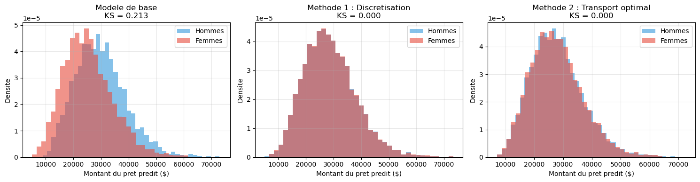
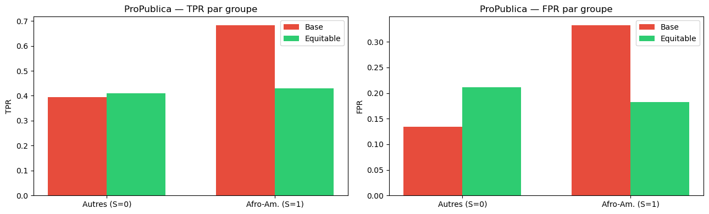

# Algorithmic Fairness in Classification and Regression

> 🇫🇷 **Résumé :** mesure et correction des biais algorithmiques sur trois jeux de données : revenus (Adult, variable sensible : sexe), récidive (ProPublica COMPAS, origine) et montant de crédit (sexe). En classification, contrainte d'égalité des opportunités avec Fairlearn : sur COMPAS, l'écart de parité démographique passe de **0,29 à 0,03**. En régression, parité démographique par discrétisation et par transport optimal : l'écart entre hommes et femmes sur le montant prédit (**4 461 $, soit 15 %**) est supprimé pour **+2,1 % de MSE**. Projet de groupe, Master 2 TIDE, Université Paris 1 Panthéon-Sorbonne.

How to build predictive models that perform well **and** treat sensitive groups fairly, illustrated on three use cases where biased decisions have real consequences: income, criminal justice and credit.

| Dataset | Task | Target | Sensitive attribute | Size |
|---|---|---|---|---|
| **Adult** (US census) | Classification | Income > $50K | Sex | 32,561 |
| **ProPublica COMPAS** | Classification | Two-year recidivism | African-American | 6,172 |
| **Credit** | Regression | Loan amount granted | Sex | 30,000 |

**Stack:** Python, scikit-learn, Fairlearn, NumPy, pandas, matplotlib.

## Methods

**Classification: equal opportunity.** A baseline logistic regression is compared with a fair model trained with Fairlearn's `ExponentiatedGradient` under a **true positive rate parity** constraint (equal opportunity). Fairness is measured with the demographic parity difference, the equal opportunity difference and group-wise TPR / FPR / selection rates (`MetricFrame`).

**Regression: demographic parity.** A Ridge baseline is compared with two post-processing methods that make the distribution of predictions identical across groups, fairness being measured with the **Kolmogorov-Smirnov distance** between the two distributions:
1. **Discretisation**: predictions are aligned by within-group quantiles on a grid of 41 levels.
2. **Optimal transport**: each prediction is mapped to the **Wasserstein barycenter** of the two group distributions, the optimal fair predictor in the mean-squared-error sense.

## Results

| Dataset | Model | Performance | Fairness |
|---|---|---|---|
| Adult | Baseline | Accuracy 0.854 | EO diff 0.066 · DP diff 0.164 |
| Adult | Fairlearn (TPR parity) | Accuracy 0.852 | EO diff **0.052** · DP diff **0.143** |
| COMPAS | Baseline | Accuracy 0.683 | EO diff 0.288 · DP diff 0.289 |
| COMPAS | Fairlearn (TPR parity) | Accuracy 0.629 | EO diff **0.029** · DP diff **0.029** |
| Credit | Ridge baseline | MSE 1.744 × 10⁸ · R² 0.331 | KS 0.213 |
| Credit | Discretisation | MSE 1.785 × 10⁸ · R² 0.316 | KS **0.000** |
| Credit | Optimal transport | MSE 1.781 × 10⁸ · R² 0.317 | KS **0.000** |

- **Adult**: the gap between men and women is reduced at almost no cost (accuracy 0.854 → 0.852).
- **COMPAS**: the bias is divided by about 10 (true positive rates go from 0.40 vs 0.68 to 0.41 vs 0.43), at the cost of 5 accuracy points: the stronger the initial bias, the higher the price of fairness.
- **Credit**: the baseline predicts $29,882 on average for men against $25,420 for women; both methods make the two distributions identical for only **+2.1 % to +2.4 % MSE**, optimal transport being slightly more efficient.





## Repository structure

```
├── notebooks/
│   └── algorithmic_fairness.ipynb   # full analysis with outputs (comments in French)
├── images/                          # figures produced by the notebook
├── requirements.txt
└── README.md
```

## How to run

```bash
pip install -r requirements.txt
jupyter notebook notebooks/algorithmic_fairness.ipynb
```

The datasets are not included. Adult is available from the [UCI Machine Learning Repository](https://archive.ics.uci.edu/dataset/2/adult) and the COMPAS data from [ProPublica](https://github.com/propublica/compas-analysis); the credit dataset was provided for the course. Place the CSV files next to the notebook.

## Context

Group project, Advanced Statistical Learning course, Master 2 TIDE (*Traitement de l'Information et Data Science en Entreprise*), Université Paris 1 Panthéon-Sorbonne, 2025-2026.
